<!-- Every block below is an animated SVG from scripts/render_cards.py. Edit data/profile.json, not this file. -->

<picture><source media="(prefers-color-scheme: dark)" srcset="./cards/hero-dark.svg"></picture>

<a href="https://suchitdev.netlify.app/work/aquaverse"><picture><source media="(prefers-color-scheme: dark)" srcset="./cards/job-aquaverse-dark.svg"></picture></a>
<a href="https://suchitdev.netlify.app/work/kannadi"><picture><source media="(prefers-color-scheme: dark)" srcset="./cards/job-kannadi-dark.svg"></picture></a>
<a href="https://suchitdev.netlify.app/work/ignition"><picture><source media="(prefers-color-scheme: dark)" srcset="./cards/job-ignition-dark.svg"></picture></a>

<a href="https://suchitdev.netlify.app/work/alethia"><picture><source media="(prefers-color-scheme: dark)" srcset="./cards/job-alethia-dark.svg"></picture></a>
<a href="https://github.com/suchitchopade3110-arch/NotAFlop"><picture><source media="(prefers-color-scheme: dark)" srcset="./cards/job-notaflop-dark.svg"></picture></a>
<a href="https://suchitdev.netlify.app"><picture><source media="(prefers-color-scheme: dark)" srcset="./cards/job-sourcetrace-dark.svg"></picture></a>

<picture><source media="(prefers-color-scheme: dark)" srcset="./cards/activity-dark.svg"></picture>

<picture><source media="(prefers-color-scheme: dark)" srcset="./cards/kit-dark.svg"></picture>

<picture><source media="(prefers-color-scheme: dark)" srcset="./cards/record-dark.svg"></picture>

<a href="https://suchitdev.netlify.app"><picture><source media="(prefers-color-scheme: dark)" srcset="./cards/link-portfolio-dark.svg"></picture></a>
<a href="https://www.linkedin.com/in/suchit-sachin-chopade-635347338/"><picture><source media="(prefers-color-scheme: dark)" srcset="./cards/link-linkedin-dark.svg"></picture></a>
<a href="https://x.com/Suchitchopade31"><picture><source media="(prefers-color-scheme: dark)" srcset="./cards/link-x-dark.svg"></picture></a>
<a href="https://suchitdev.netlify.app/Suchit_Sachin_Chopade_Resume.pdf"><picture><source media="(prefers-color-scheme: dark)" srcset="./cards/link-resume-dark.svg"></picture></a>
